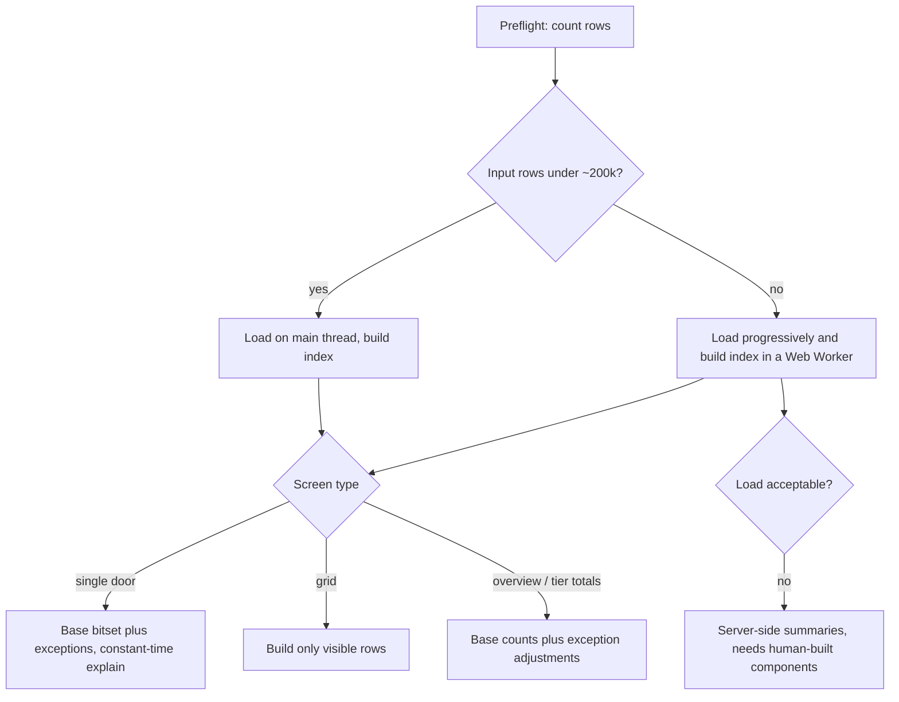

Assortments in the millions aren't a problem for CPU. Millions of simple lookups take tens of milliseconds in JavaScript. What breaks a browser app is **storing** millions of door × SKU results as objects, and **loading** a large number of input rows through the Dataverse connector.

The fix is to keep the assortment broken into its parts and only compute what a screen actually shows. Then storage stays tiny even when the full assortment runs to millions or billions of door × SKU pairs. What you really need to measure is how many input rows you fetch.

## 1. Why the numbers are smaller than they look

| Symbol | Meaning                                                           |
| ------ | ----------------------------------------------------------------- |
| D      | Doors                                                             |
| S      | Active SKUs                                                       |
| T      | Tiers                                                             |
| P      | Distinct Product Line values                                      |
| K      | Distinct (Tier, Product Line) pairs in use, at most min(D, T × P) |
| R      | Tier rule rows, at most T × S                                     |
| E      | Exception rows (door-level plus retailer-level)                   |
| A      | Total door × SKU pairs, up to D × S                               |

Your engine rules mean a door's assortment is:

$$
\text{assortment}(d) = \text{base}(\text{tier}_d, \text{PL}_d) \;\oplus\; \text{retailerExc}(r_d) \;\oplus\; \text{doorExc}(d)
$$

- **The base list depends only on tier and product line.** Every door sharing those two values has the same base, so there are only K base lists, and K is usually small (for example 6 tiers × 12 product lines gives at most 72).
- **Exceptions are sparse adjustments.** Most door × SKU pairs have none.
- **Retailer exceptions should not be copied onto every door.** Look them up through the door's `cr380_distributornamecode` at read time. A retailer with 500 doors and 100 exceptions would otherwise become 50,000 rows.
- So the space you actually need is about K × S + E, not D × S.

### Worked example ("millions")

Say D = 3,000, S = 5,000, T = 6, P = 12 (so K ≤ 72), R = 18,000, E = 20,000, and doors average 1,500 SKUs. That gives A ≈ 4.5M.

| Representation                                                      | Approximate memory                                 | Feasible?                                                    |
| ------------------------------------------------------------------- | -------------------------------------------------- | ------------------------------------------------------------ |
| One object per pair `{doorId, skuId, reason}`                       | 4.5M × about 100 B ≈ **450 MB**                    | No: crashes mobile and is risky inside the Power Apps iframe |
| One `Set` of SKU ID strings per door                                | 4.5M × about 30 B ≈ **135 MB**                     | Marginal                                                     |
| **Base list as a bit array (bitset) per pair, plus exception maps** | 72 × 625 B ≈ **45 KB**, plus exceptions under 1 MB | **Yes**, under 5 MB including inputs                         |

Byte sizes are V8 approximations, but the gap is roughly 100×.

## 2. Recommendations by volume

### Small: under about 250k pairs and under about 20k input rows

_(e.g. 300 doors × 800 SKUs)_

- Calculate per door with a `Set` of the door's product lines and a `Map` of exceptions, on the main thread.
- Plain object results are fine.
- Even here, keep the engine's public API the same as for the larger sizes, so you can scale up without rewriting callers.

### Medium: 250k to 10M pairs and 20k to 200k input rows

_(your likely range)_

- **Map each SKU ID (a GUID) to a small integer index once at load.** Every later structure uses integers rather than strings.
- **Store each base list as a `Uint32Array` bitset**: one bit per SKU, so 5,000 SKUs take 625 bytes.
- **Index exceptions** with `Map<doorIdx, Map<skuIdx, action>>`, and the same structure keyed by retailer.
- **Look up rather than expand:** `effective(d,s) = doorExc ?? retailerExc ?? baseBit`.
- **Calculate counts, not lists, for aggregates.** Precompute the number of SKUs in each base list once; a door's count is that base count plus or minus its effective exceptions. A whole-portfolio total is then roughly D + E operations, about 1 ms.
- **Build lists only for the rows a virtualised grid is showing**, by walking the base bitset and applying the exceptions.
- **Explain on demand, never store reasons.** `explain(door, sku)` re-runs the chain in constant time and returns a code such as `NOT_IN_TIER_RULES`, `AXIS_MISMATCH`, `SKU_INACTIVE`, `RULE_DISABLED`, `ADDED_BY_DOOR_EXCEPTION` or `REMOVED_BY_RETAILER_EXCEPTION`. This meets Principle XIII's "why" requirement at no storage cost.

### Large: 10M to 100M+ pairs, or 200k to 1M input rows

Everything from Medium, plus:

- **A Web Worker** to build the index and run portfolio-wide recalculations, sending results back as typed arrays (which transfer without copying), so the UI stays responsive within the 100 ms input-latency target. Check that workers are allowed inside the Power Apps host before relying on this.
- **Progressive loading.** Use the generated `count` option to size each fetch up front and show progress. Keep each `skipToken` page as a small typed array and discard the raw JSON straight away.
- **Pick the format by density.** If a door's exceptions are a large share of SKUs, store them as a bitset; otherwise use a sorted `Int32Array`.
- **Recalculate narrowly.** Keep a version number per tier, door and retailer. A tier-rule change rebuilds only that tier's base lists (about 12); a door's tier change updates one entry.
- **Avoid compressed-bitmap libraries** such as Roaring unless you've measured a need: `roaring` is Apache-2.0, which conflicts with the constitution's MIT-only rule.

### Extra large: inputs too big to load into the browser

_(e.g. over 1M input rows, or a load that takes minutes)_

At this point network transfer is the limit: 1M rows is at least 200 pages of 5,000. Options, all of which need human-built components (Principle I) and probably a constitution amendment:

- **Server-side summaries**, such as rollup columns or a scheduled flow that writes per-tier or per-pair counts.
- **A saved snapshot table of results.** This is a last resort, and it now contradicts the "derived, never persisted" line you added. Dataverse throttling makes it slow: the generated services only create one record per call, and the limits are about 6,000 requests per 5 minutes per user. Writing 4.5M rows that way would take about **62 hours**, the snapshot would go stale on every edit, and it would use a lot of Dataverse database capacity.

## 3. Load cost

| Input      | Rows in the example | Columns to fetch | Pages at 5,000 rows |
| ---------- | ------------------- | ---------------- | ------------------- |
| Doors      | 3,000               | 4                | 1                   |
| SKUs       | 5,000               | 4                | 1                   |
| Tier rules | 18,000              | 4                | 4                   |
| Exceptions | 20,000              | 6                | 4                   |
| Tiers      | ~6                  | 3                | 1                   |

That's about 11 requests in total. Fetching only the needed columns (`select`) keeps each row to a few hundred bytes of JSON. Exceptions and doors are what grow fastest, so filter exceptions on the server by status, and by door or retailer on single-door screens.

## 4. Choosing at runtime

## 5. Testing at these sizes (fits Principle XIV)

- **Reference engine:** a deliberately naive door × SKU loop, used only in tests.
- **Equivalence tests:** generate random datasets and check that the optimised and reference engines always agree, including tricky product-line values, conflicting exceptions and inactive records. `fast-check` (MIT) does this well.
- **Benchmarks:** `vitest bench` with synthetic Small, Medium and Large datasets, recording:
  - time to build the index;
  - time per door, against the 200 ms target;
  - time for portfolio-wide counts;
  - memory used, optionally checked in Playwright on Chromium.
- **Coverage:** synthetic generators also make the 100% branch-coverage requirement easy to hit.

**What I need from you:** rough current and expected counts for D, S, R and E, and whether a door can ever have more than one Product Line. With those I can confirm which size category applies and size the budgets exactly.
